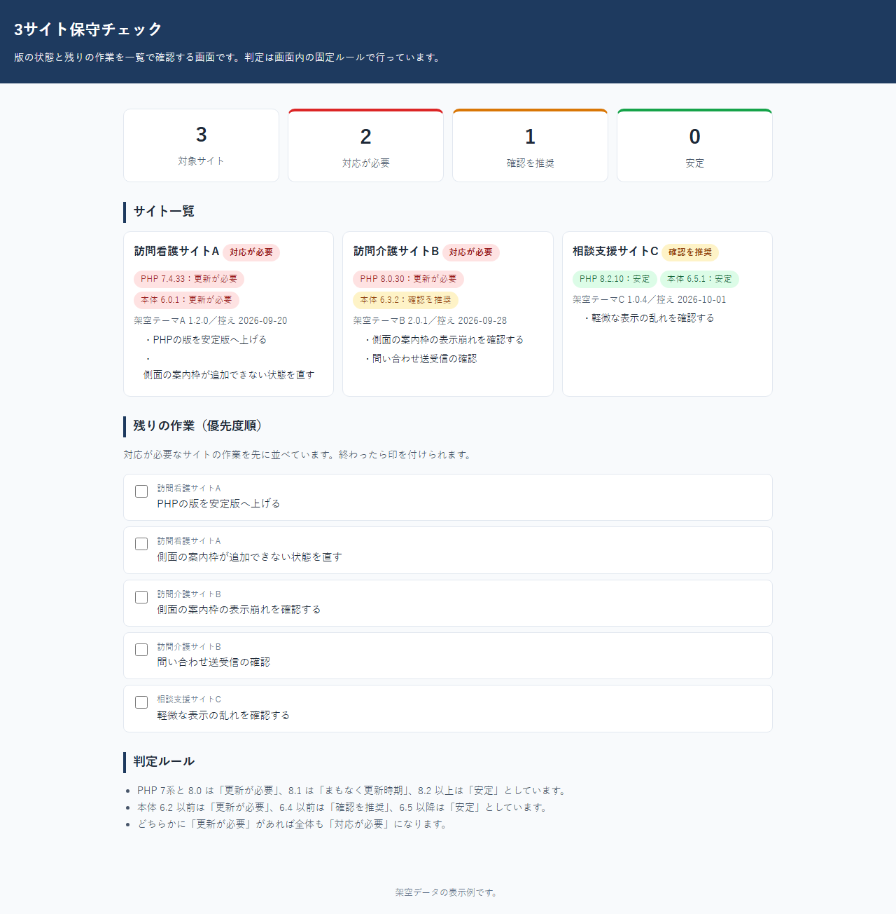
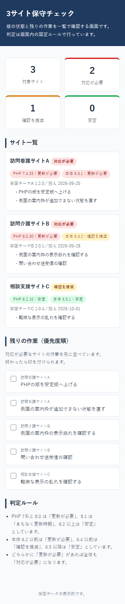

# 3サイト保守チェック

複数のサイトの版と残り作業を一覧で見る小さな画面です。

## このPOCで確かめたこと
- 3件の架空サイトの版から状態（対応が必要／確認を推奨／安定）を判定して一覧表示できる。
- 古い版の判定（例：PHP 7.4 を更新が必要とする）と概要件数の数え上げをテストで確認した。
- 対応が必要なサイトの作業を先頭に並べた残り作業の一覧を表示できる。
- 判定は画面内と `lib/check.js` の固定ルールで行い、外部の接続は使っていない。

## 作っていない範囲
- 実サーバへの接続や版の自動取得
- 更新作業そのもの（移行・復旧・表示修正）
- 利用者管理や通知

## 次の進め方
- 対象サイトを増やせる形にし、控えの日付と担当のメモを足す。
- 版の取得を手入力から切り替えられるようにする。
- 作業の終わりを記録できるようにする。

## 動かし方
- 静的表示：`docs/index.html` をブラウザで開く。
- テスト：`npm install` 後に `npm test` を実行する。

データはすべて架空です。AIは使っていません。
